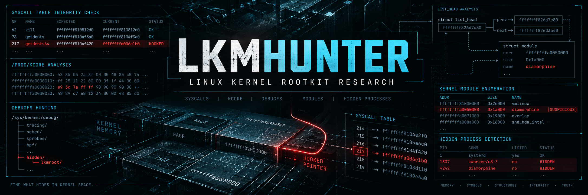
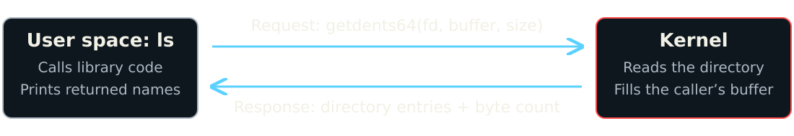
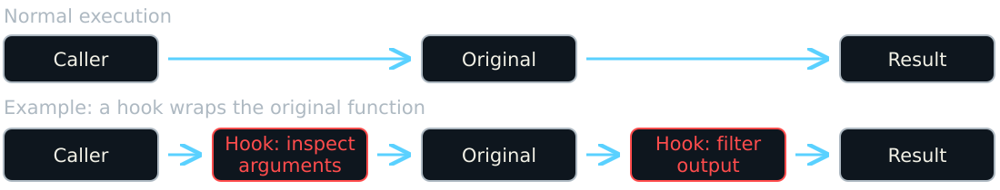
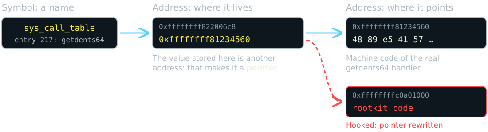
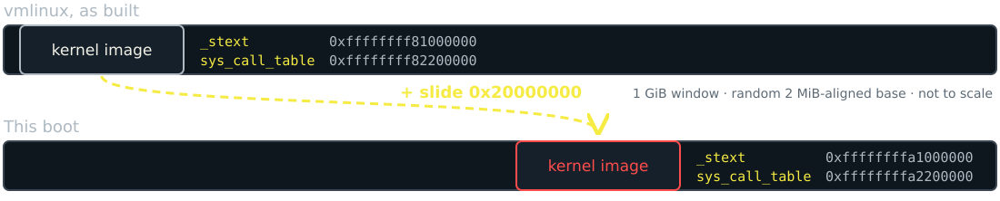
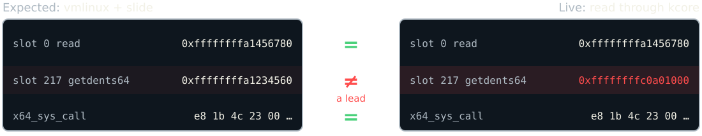

<!-- _class: invert title -->
# What if the kernel lies?
## Hunting Linux rootkits

Mega Sekurak Hacking Party

<!-- 00:00–00:20. Prep deck, then terminal/editor for the three investigations. Presenter commands and source bookmarks live in https://github.com/ponquersohn/lkmhunter/blob/master/docs/workshops/mshp/script.md. No need to return to slides between samples. -->

---
<!-- _class: invert whoami -->
## # whoami


### Professional

- Global Threat Defense Engineering Director at PepsiCo
- Active member of ISSA International
- Ex-Symantec, ex-ISSA Polska Board Member
- CISSP since 2010 till recently
- OSEP too
- Locked Shields veteran

### Personal

- Father of two to-be hackers
- Coffee lover: more ways to brew it than php had vulnerabilities
- Homegrown researcher and builder of home appliances
- Snowboarder in winter, biker all year

<!-- 00:20–00:45. Short intro only; move straight on. -->

---
## Rootkit: the system lies to you


Software that **hides an attacker's presence** so they keep control of a compromised machine.

**Example:** a process keeps running but disappears from `ps`. Nothing stopped; you just can't see it.

Hiding ≠ privileges ≠ persistence.

**Today: three rootkits on a lab machine. What evidence is left?**

<!-- 00:45–01:05. We already know a rootkit was loaded; the question is what evidence remains. Root historically refers to privileged control; the name does not mean every rootkit grants root itself. A rootkit can hide its own components or another payload. The process example is filtered visibility, not process termination. Concealment, privilege escalation, and persistence can coexist, but none implies the others. We investigate existing control, not the initial intrusion. Do not explain user space or kernel space yet; that comes next. -->

---
## Linux basics: user space and kernel space

Two execution domains, separated by a **privilege boundary**.

<div class="cols">
<div>
<h3>User space — applications</h3>
<p>Shells, browsers, services,<br>tools such as <code>ls</code>, and libraries.</p>
<p>Processes normally have isolated memory and restricted CPU privileges.</p>
</div>
<div>
<h3>Kernel space — the OS core</h3>
<p>CPU scheduling, memory,<br>filesystems, networking, drivers.</p>
<p>Privileged code that manages resources and access to hardware.</p>
</div>
</div>

**Even a root shell runs in user space.**<br>
Programs request kernel services through **system calls**.

<!-- 01:05–01:30. Simplified Linux execution model, not two physical memory chips or two separate CPUs. User processes normally have isolated virtual address spaces, with explicit sharing possible. CPU execution mode and a process's credentials are different: UID 0 does not turn application code into kernel code. The kernel applies permissions and policy to requests. Transition: how does an application ask for a service across this boundary? -->

---
## Your program asks. The kernel answers.

A **system call** asks the kernel to perform an operation:<br>
read a directory, open a file, or create a process.



The syscall **number** selects the operation; **arguments** supply its inputs.<br>
The kernel returns a **result or error** and may write data into a buffer.

<!-- 01:30–02:05. Diagram shows one directory-read round trip, not the whole ls execution. A library call need not map one-to-one to a syscall. getdents64 writes directory entries into a user-space buffer and returns the byte count, zero at end, or an error. fd is an open directory's file descriptor. Brief terminal switch: strace -e trace=openat,getdents64 ls /root/workshop01, from https://github.com/ponquersohn/lkmhunter/blob/master/docs/workshops/mshp/script.md. Point to one getdents64 call, its arguments, and returned byte count, then return. Descriptor numbers will matter again for Singularity. -->

---
## A module brings code into the kernel

A **loadable kernel module (LKM)** extends the running kernel.<br>
Its code executes with **kernel privileges**.

| Stage | What happens |
| --- | --- |
| Build | C source becomes a `.ko` file: code, data, and metadata |
| Load | The loader allocates memory, resolves symbols, and calls the init function |
| Unload | The exit function cleans up; the kernel releases module memory |

`struct module` tracks the loaded module and its memory regions.

**Drivers and rootkits can enter through the same door.**

<!-- 02:25–03:00. Open https://github.com/ponquersohn/lkmhunter/blob/master/docs/workshops/mshp/demo/mini-module/mshp_hello.c using https://github.com/ponquersohn/lkmhunter/blob/master/docs/workshops/mshp/script.md. Point to persistent data, init/exit functions, and their registration macros. This module only logs messages. Normal successful load/unload lifecycle is shown; unloading needs kernel support and can be refused while in use. Init-only code can be freed after successful initialization. On-disk ELF and runtime region dumps are different artifacts. Loading depends on capabilities and enforced policy, not merely UID 0. struct module layout depends on the exact build. BTF/DWARF help discover layout; neither is a trusted expected memory image. -->

---
## A hook puts code on the path

A **hook** runs additional code at a chosen point in an operation. It can observe the operation or change its behavior.



**Example:** read a directory, then remove names from the returned list.

A hook can also **replace the operation entirely**.

<!-- 03:00–03:35. Diagram is chronological execution, not a literal stack/call graph. Both red boxes are stages of one wrapper, not necessarily two installed hooks. This example calls the original and filters its returned buffer; observation-only callbacks and full replacements have different flows. A hook does not inherently imply malicious code. On the supplied newer Diamorphine, direct calls in x64_sys_call change instead. KoviD uses ftrace callbacks. Do not imply modern syscall dispatch always consults sys_call_table. Explain mechanisms before scanner output. -->

---
## How do you hook execution?

| Space | Approach | What changes? | Where it acts |
| --- | --- | --- | --- |
| <span class="cyan">User</span> | `LD_PRELOAD` — library interposition | Library function lookup in the process | Dynamically linked user processes |
| <span class="cyan">User</span> | `ptrace` — process control | Traced process's registers and memory | Selected user processes |
| <span class="red">Kernel</span> | Direct patching — the classic | Syscall-table pointers or kernel instructions | Kernel code / data — direct memory writes |
| <span class="red">Kernel</span> | ftrace — registered callbacks | Callbacks on instrumented function entry | Kernel functions |
| <span class="red">Kernel</span> | eBPF — programs loaded from user space | Verified programs attached to kernel hooks | Supported kernel hooks |

**eBPF: kernel-side behavior without loading your own `.ko`.**

Permissions, kernel configuration, and attachment type determine what is possible.

<!-- 03:35–04:15. LD_PRELOAD interposes dynamically resolved library functions; it does not hook kernel execution. Static binaries and direct syscalls bypass that interposition; secure-execution mode restricts preload behavior. Approaches, not a chronological evolution: ptrace predates ftrace; eBPF is established, not brand new. Classic syscall-table replacement is not a universal current syscall-dispatch hook; the supplied newer Diamorphine patches direct calls in x64_sys_call. Ptrace runs a user-space tracer controlling selected processes, not an arbitrary kernel hook. It returns as the fd=0 workaround. Ftrace redirection requires supported configuration/API/flags; not every callback redirects. eBPF is loaded/attached by user space but executes in the kernel here; verifier, helpers, program/attachment types, and permissions constrain it. It is not arbitrary kernel text patching or unrestricted replacement of syscalls. eBPF gets context only; no programming detour. An LKM loads kernel code and may use hook mechanisms. -->

---
## Follow an address: name → location → contents



An **address** is a location. A **symbol** names it. A **pointer** holds one.

**A hook rewrites a pointer: same slot, different destination.**

<!-- 04:15–04:40. Theory only. Addresses are illustrative, not captured; 217 is getdents64 on x86-64. The diagram follows one table entry: the symbol names the table, the slot holds a pointer, the pointer leads to machine code. The value and the bytes at that address are different things. Kernel and programs use virtual addresses; physical translation stays in https://github.com/ponquersohn/lkmhunter/blob/master/docs/workshops/mshp/script.md. Classic Diamorphine-style hooks rewrite this slot; the supplied newer build patches direct calls in x64_sys_call instead, so do not imply all dispatch reads sys_call_table. Transition: to spot a rewritten pointer we need to know what it should be: the kernel as built. -->

---
## vmlinux: the kernel before it booted

| File | What's in it |
| --- | --- |
| `/boot/vmlinuz-$(uname -r)` | Compressed boot image; `extract-vmlinux` unpacks the ELF |
| `vmlinux` from the debug package | Code bytes as built, symbol table, DWARF types |
| `/boot/System.map-$(uname -r)` | Symbol → link-time address; no code |
| `/sys/kernel/btf/vmlinux` | Types and struct layouts; no addresses |

```text
$ nm vmlinux | grep -w _stext
ffffffff81000000 T _stext
```

**Our known-good baseline: what the code and pointers should be.**<br>
Only if it matches this exact build.

<!-- 04:40–05:15. vmlinux is the uncompressed ELF kernel image; vmlinuz is the compressed bootable form. Debug package path example: /usr/lib/debug/boot/vmlinux-$(uname -r). Link-time addresses start at the compile-time base (0xffffffff81000000 on typical x86-64 builds). Build IDs must match; kernel banners and consistent KASLR anchors give extra validation. lkmhunter discovers these in standard local locations and can run extract-vmlinux; it downloads nothing. BTF describes types, not runtime addresses or trusted expected memory. Transition: that is what the kernel should be. Now the live side: how do we find what it actually is? -->

---
## kallsyms and kcore: what we see, and why

```text
$ sudo grep -w _stext /proc/kallsyms
ffffffffa1000000 T _stext
$ sudo readelf -lW /proc/kcore     # LOAD segments = kernel text,
                                   # modules, direct map, vmalloc
```

| | `/proc/kallsyms` | `/proc/kcore` |
| --- | --- | --- |
| What | Every symbol the kernel knows: core and loaded modules | Live kernel virtual memory as an ELF core file |
| Why it exists | Backtraces, ftrace, kprobes, BPF | Debugging the running kernel with GDB |
| Without root | Addresses read as zero (`kptr_restrict`) | No access |

**Both are the running kernel describing itself. A rootkit runs there too.**

<!-- 05:15–05:50. Illustrative output, not captured from this guest. kallsyms: address, type letter (T/t text, D/d data; lowercase = local), name, and [module] for module symbols. It is the kernel's own symbol table, kept for oops backtraces and tracing. kcore is read-only here; its "size" is the mapped address range, not RAM. Segment list depends on architecture and configuration. Both are answered by the running kernel, so a rootkit can filter or redirect them: Singularity is the case where that matters. -->

---
## Kernel memory comes with a maths tax

**Got an address? Great. It's not a file offset.**

```text
0xffffffff81234560   ≈ 16 EiB: near the top of the 64-bit address space
ls -l /proc/kcore    → 128T, a sparse file, and nowhere near that big
```

It's a **virtual address**. kcore's ELF segments map address ranges to file offsets:

```text
$ sudo readelf -lW /proc/kcore
  LOAD  Offset 0x00007fff81001000  VirtAddr 0xffffffff81000000   ← kernel text

offset = 0x7fff81001000 + (0xffffffff81234560 − 0xffffffff81000000)
       = 0x7fff81235560          → seek there, read the bytes
```

<!-- 05:50–06:15. Illustrative values for x86-64, matching the address on the pointer slide; use the guest's readelf output. 0xffffffff81234560 is about 1.8 × 10^19, just under 2^64 = 16 EiB. kcore's size is the mapped address range, not RAM; it is sparse, so ls shows ~128T on 4-level paging. General rule: offset = p_offset + (address − p_vaddr) for the LOAD segment that contains the address. No physical-address calculation in this read. Kallsyms already gives runtime addresses: do not add KASLR here. KASLR matters only when bringing vmlinux addresses into this boot, which is the next slide. The maths tax is bookkeeping any debugger does; the optional GDB example in https://github.com/ponquersohn/lkmhunter/blob/master/docs/workshops/mshp/script.md shows name → address → bytes. -->

---
## KASLR: the kernel moves every boot

Name → address → bytes works. **Then the kernel moves.**



**Why:** a random base each boot, so exploits can't hard-code addresses.

**Beat it:** everything moves together. **One known address gives the slide.**

<!-- 06:15–07:00. Illustrative addresses matching earlier slides; use the guest's actual values. KASLR = Kernel Address Space Layout Randomization. Recap first: name → address → bytes works, but vmlinux addresses do not match this boot. x86-64: the core image gets one 2 MiB-aligned random offset inside a 1 GiB window, roughly 9 bits of entropy, which is why a single leaked pointer defeats it; kptr_restrict and dmesg_restrict exist to stop those leaks. Runtime address = vmlinux address + slide, for core-kernel symbols only; modules and heap are randomized separately. Live kallsyms values are already runtime addresses: do not add the slide again. As root we read kallsyms, so KASLR stops attackers guessing, not us measuring. Diagram not to scale. Transition: once we know the slide, we can do the maths. -->

---
## Do the maths: two images of one kernel



Relocate vmlinux, read kcore: **two images that line up.**

**A mismatch is a lead to explain. A match covers only what was compared.**

<!-- 07:00–07:30. Illustrative values continuing the earlier slides: expected getdents64 handler 0xffffffff81234560 + 0x20000000 = 0xffffffffa1234560; the live slot points into module memory at 0xffffffffc0a01000. On the supplied newer Diamorphine build the slot can still match and the direct call inside x64_sys_call changes instead: that is why instructions are compared too. Matching kernel identity matters before comparison. Missing input ≠ completed check ≠ no findings. Transition: doing this by hand for every slot, every boot, is tedious. -->

---
## That's why I built lkmhunter


Tools to **detect**, and sometimes **disarm**, running rootkits.

- **Baseline:** matching vmlinux, slide measured and cross-checked
- **Syscalls:** live table and dispatcher vs. the expected image
- **Ftrace:** callback → the module that owns it
- **Disarm:** original bytes written back over a hook

<!-- 07:30–08:00. Personal motivation first: the maths on the previous slide, by hand, for every slot and every boot, is why the tool exists. Python library plus CLI; kernel memory access, symbol resolution, KASLR relocation, baselines and struct layouts share one session. x86-64 little-endian only. Module recovery works even when the module name was erased, and can dump its memory regions. "Sometimes" disarm: copy restores baseline bytes through the memory helper; it is not a cleanup guarantee. Transition: let's see it on a live kernel. -->

---
<!-- _class: invert demo -->
## Let's get our hands dirty

<div class="cols" style="align-items: center;">
<div style="font-size: 0.8em;">
<h3>Three samples. Three reasons to look again.</h3>
<p><strong>Diamorphine</strong><br>Which syscall paths changed? Can visibility be restored?</p>
<p><strong>KoviD</strong><br>Who owns this ftrace callback? What survives in memory?</p>
<p><strong>Singularity</strong><br>Is our evidence being filtered before we see it?</p>
</div>
<div>

</div>
</div>

<!-- 08:00–10:00. First, before loading anything — Terminal stop (90 s): run the KASLR block in https://github.com/ponquersohn/lkmhunter/blob/master/docs/workshops/mshp/script.md before loading Diamorphine; lkmhunter finds the matching baseline, measures the slide from live symbols and cross-checks it on several anchors. Zero addresses mean unavailable visibility, not proof of no randomization. If nokaslr is active, report slide 0 honestly and use the prepared labelled second boot capture; no live reboot. Exit codes: 0 complete/no suspicious finding, 1 complete/findings, 2 incomplete/unavailable/failed. Then the hand-off: Hand off to https://github.com/ponquersohn/lkmhunter/blob/master/docs/workshops/mshp/script.md at “10–12 · Diamorphine”. Keep the deck here throughout the three acts. No demo commands, expected counts, or historical addresses on slides. Eight-minute prep is now ten minutes including the KASLR terminal stop. -->

---
## Better than detecting: don't let it load

```text
module.sig_enforce=1            # or CONFIG_MODULE_SIG_FORCE=y
$ sudo insmod diamorphine.ko
insmod: ERROR: could not insert module diamorphine.ko:
        Key was rejected by service
```

All three samples were **unsigned `.ko` files**: one boot parameter kills that path. Lockdown enforces it too.

Signed ≠ harmless, and eBPF or kernel exploits don't need a `.ko`.

**Detection tells you it happened. Prevention means it didn't.**

<!-- 38:00–39:00. First slide back from the terminal investigations. Illustrative output. Enforcement requires the kernel to trust the signing keys; distribution kernels sign their own modules, so only third-party/out-of-tree modules are affected and need signing with an enrolled key (e.g. MOK on Secure Boot systems). lockdown=integrity also forces signature checks; lockdown=confidentiality additionally restricts /proc/kcore, which is exactly the view this talk relied on: prevention and live investigation pull in different directions. This lab does not demonstrate bypassing these controls. Sources on the reference slide. -->

---
<!-- _class: invert title -->
# Found it. Removed it.<br>Clean?

## No. Don't fight it. Reimage.

“Nothing found” needs a second sentence:<br>what did you inspect, and what could you not see?

<!-- 39:00–39:30. Final remarks. Removing the module or restoring bytes is analysis and containment, not remediation: kernel code ran with full privileges and could have changed anything else (other hooks, files, initramfs, boot chain, credentials), and every check afterwards still asks that same kernel. Collect evidence, then rebuild from known-good media and rotate credentials. "Nothing found" has the same limit: a result covers only the paths inspected, through a kernel you no longer trust. More local views help find discrepancies but share the running kernel's trust boundary; external acquisition changes assumptions but still needs sound capture and interpretation. -->
---
<!-- _class: invert title -->
# Thank you

## Questions?

Mega Sekurak Hacking Party

<!-- 39:30–40:00, then Q&A. Leave this up during questions. -->
---
## References

<div class="cols" style="font-size: 0.78em;">
<div>
<h3>lkmhunter</h3>
<ul>
<li><a href="https://github.com/ponquersohn/lkmhunter">github.com/ponquersohn/lkmhunter</a></li>
<li><a href="https://github.com/ponquersohn/lkmhunter/blob/master/README.md">Documentation</a>: CLI, Python API, memory helper</li>
</ul>
<h3>Samples</h3>
<ul>
<li><a href="https://github.com/m0nad/Diamorphine">Diamorphine</a>: syscall-table and dispatcher hooks</li>
<li><a href="https://github.com/carloslack/KoviD">KoviD</a>: ftrace hooks, hidden module</li>
<li><a href="https://github.com/MatheuZSecurity/Singularity">Singularity</a>: filtered evidence</li>
</ul>
</div>
<div>
<h3>Kernel documentation</h3>
<ul>
<li><a href="https://man7.org/linux/man-pages/man2/syscalls.2.html">syscalls(2)</a>: the user/kernel interface</li>
<li><a href="https://docs.kernel.org/trace/ftrace-uses.html">Ftrace callbacks</a>: hooking through ftrace</li>
<li><a href="https://docs.kernel.org/filesystems/proc.html">/proc</a>: kallsyms and kcore</li>
<li><a href="https://docs.kernel.org/admin-guide/sysctl/kernel.html">kptr_restrict</a>: hiding kernel pointers</li>
<li><a href="https://docs.kernel.org/bpf/btf.html">BTF</a>: types without vmlinux</li>
<li><a href="https://docs.kernel.org/security/self-protection.html">Kernel self-protection</a>: KASLR</li>
<li><a href="https://docs.kernel.org/admin-guide/module-signing.html">Module signing</a>: <code>sig_enforce</code></li>
<li><a href="https://man7.org/linux/man-pages/man7/kernel_lockdown.7.html">Kernel lockdown</a></li>
</ul>
</div>
</div>

<!-- Outside the timed path. Leave up after Q&A. lkmhunter first, then the samples, then kernel docs in slide order (syscalls → hooks → kallsyms/kcore → vmlinux/BTF → KASLR → prevention). -->

---
<!-- _class: invert section -->
# Backup slides

<!-- Outside the timed path. Use only for questions. -->

---
## Unlinking is not unloading

```text
Visible list:   A ←→ B ←→ C
After unlink:   A ←─────→ C

Memory:         B's code, data, and callbacks remain
```

**DKOM:** direct kernel object manipulation.

`/proc/modules` and `/sys/module` expose different views.<br>
An object can disappear from one view and survive elsewhere.

<!-- Backup, for questions about hiding from lsmod. Conceptual list, not synchronization-safe implementation advice. Diamorphine retains a sysfs clue; KoviD removes both normal views. Sysfs also includes built-in modules, so a difference alone is not a verdict. -->

---
## Diamorphine changes where the dispatcher jumps

<style scoped>
p { margin-top: 0.3em; margin-bottom: 0.3em; }
pre { margin-top: 0.3em; margin-bottom: 0.3em; }
</style>

<div class="cols">
<div>
<h3>C: select a syscall</h3>

```c
// x86-64 Linux 6.9+, abbreviated
long x64_sys_call(const struct pt_regs *regs,
                  unsigned int nr)
{
    switch (nr) {
    case 217:
        return __x64_sys_getdents64(regs);
    // ... other syscall numbers ...
    default:
        return __x64_sys_ni_syscall(regs);
    }
}
```

</div>
<div>
<h3>Assembly: branch to its handler</h3>

```asm
; Illustrative compiler output
; ESI = nr, RDI = regs
cmp esi, 217
je  .getdents64
; ... other cases ...

.getdents64:
; before / after Diamorphine:
jmp __x64_sys_getdents64
jmp hacked_getdents64
; Same branch site. New destination.
```

</div>
</div>

<div style="font-size: 0.72em;">

**The patch:** `E9 [rel32]` — keep the opcode, change the four offset bytes.<br>
Destination = address of the next instruction + signed `rel32`. `E8` calls work the same way.

**Undo it:** restore the original 5 bytes from matching, relocated `vmlinux`; read back and rescan. In the demo, repair directory hooks first; keep `kill` to unhide, then unload.

</div>

<div style="font-size: 0.42em;"><a href="https://github.com/torvalds/linux/blob/v6.9/arch/x86/entry/syscall_64.c">Linux: x64_sys_call</a> · <a href="https://github.com/m0nad/Diamorphine/blob/master/diamorphine.c">Diamorphine: flipswitch_func</a></div>

<!-- Backup. Native x86-64 path, simplified: entry/exit work, tracing, seccomp, and bounds checks omitted. Syscall number arrives in RAX and is saved in pt_regs; nr=217 is getdents64 on this ABI. Upstream switched dispatch in 6.9; vendor backports and compiled branch layouts vary, so inspect the actual build. The generated switch becomes comparisons and direct transfers; do not promise a particular decision-tree shape. The supplied local Diamorphine testbed source, diamorphine.c:412–502, scans x64_sys_call for E8 CALL or E9 JMP rel32 instructions targeting the original handlers. Destination = instruction address + 5 + sign-extended displacement; it changes the four displacement bytes while retaining the opcode. It temporarily clears CR0.WP for writes, then restores protection. Older versions replace syscall-table slots instead. lkmhunter compares decoded transfers against relocated matching vmlinux. https://github.com/ponquersohn/lkmhunter/blob/master/docs/workshops/mshp/script.md#L660-L714 selects only the two directory findings, backs up live bytes, restores five bytes per site with lkmhunter copy, and verifies readback. Keep the kill hook until signal 63 has exposed the module; rmmod runs its cleanup, which searches for reverse transfers and restores kill. The directory branches have already been restored. Raw live writes via lkm_mem do not synchronize CPUs: this is the rehearsed disposable VM procedure, not a general safe kernel text-patching API. Restored dispatch is containment, not proof of a clean system. -->

---
## KoviD changes where ftrace returns

<style scoped>
p { margin-top: 0.3em; margin-bottom: 0.3em; }
pre { margin-top: 0.3em; margin-bottom: 0.3em; }
</style>

<div class="cols">
<div>
<h3>At the start of a kernel function</h3>

```asm
filldir64:
    ; tracing off: NOP at entry
    ; tracing on:
    call ftrace_trampoline
    ; original function body follows
```

<div style="font-size: 0.72em;">

The trampoline saves context, calls registered callbacks, then restores context and resumes execution.

**Normal tracing:** resume the original body.<br>
**KoviD:** resume at its replacement instead.

</div>
</div>
<div>
<h3>Inside KoviD's callback</h3>

```c
// fh_ftrace_thunk, abbreviated
regs = ftrace_get_regs(fregs);
hook = container_of(ops,
                    struct ftrace_hook, ops);

if (!within_module(parent_ip, THIS_MODULE))
    regs->ip = (unsigned long)hook->function;
```

<div style="font-size: 0.72em;">

`SAVE_REGS | IPMODIFY` allows the saved IP to change. The replacement can hide entries, then call the original; the caller check avoids redirecting that call again.

</div>
</div>
</div>

<div style="font-size: 0.72em;">

**The same pattern appears in other rootkits:** register a callback → redirect → filter results.

**Follow the callback:** `ftrace_ops.func` → module memory → owner.<br>
Tracing and livepatch also register callbacks; inspect what the callback does.

</div>

<div style="font-size: 0.42em;"><a href="https://docs.kernel.org/trace/ftrace-uses.html">Kernel: ftrace callbacks and IPMODIFY</a> · <a href="https://github.com/carloslack/KoviD/blob/master/src/sys.c">KoviD: fh_ftrace_thunk</a></div>

<!-- Backup. Simplified dynamic ftrace on the demonstrated x86-64 setup; exact trampoline routing, register ABI, and entry offsets vary with kernel build. Instrumentation comes from compiler fentry/mcount sites. The kernel patches eligible entry sites through its own text-patching machinery; the rootkit uses the callback API. A trampoline is kernel glue that preserves the required register context, invokes a callback or dispatcher, and resumes at the saved IP. Distinguish that glue from KoviD's C callback fh_ftrace_thunk: the latter obtains pt_regs using ftrace_get_regs, recovers its enclosing ftrace_hook from ops, checks within_module(parent_ip, THIS_MODULE), and changes regs->ip to hook->function only for outside callers. Local authority: testbed/rootkits/KoviD/src/sys.c:1187–1197 and 1377–1418. Registration also sets the kernel-version-specific recursion flag; SAVE_REGS and IPMODIFY are the flags material to redirection here. The parent-IP check permits calls through the saved original function address from a module replacement without repeatedly redirecting; it is distinct from ftrace callback recursion protection. KoviD hooks ordinary kernel functions as well as syscall wrappers, including filldir/filldir64, so clean syscall dispatch does not exclude these hooks. Other rootkits can use the same API with different guards or targets. ftrace_ops.func is the callback, not necessarily the replacement or trampoline; follow the registered callback into its owner and inspect the hook data for individual replacements. Normal removal unregisters callbacks and clears filters before freeing module memory; the kernel unregister API waits until callbacks are no longer being called. Do not erase active ftrace entry calls by blindly copying vmlinux bytes. -->
