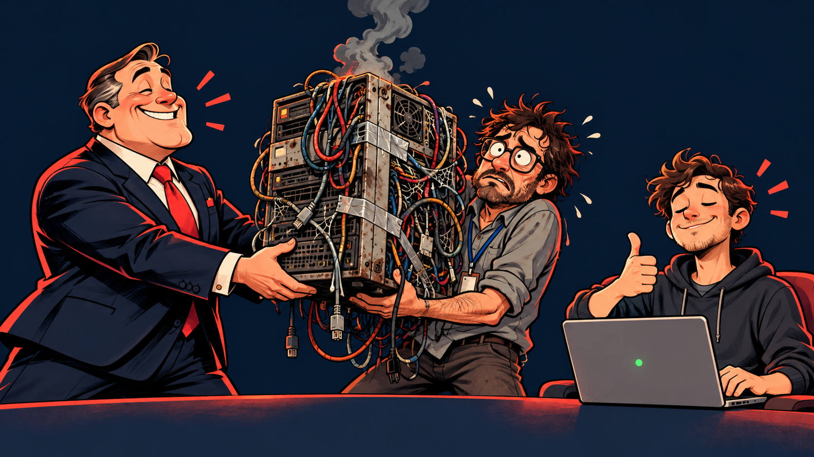
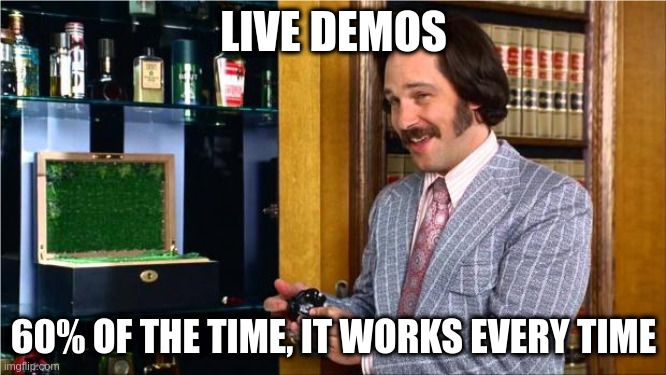

<!-- _class: invert title -->
# Fresh Linux, Dirty Internet
## Hardening from zero
Mega Sekurak Hacking Party

<!-- 00:00–00:30. Title, then the acquisition handover scenario. Use README.md as the hardening learning guide. -->

---
<!-- _class: invert whoami -->
## # whoami

### Professional

- Global Threat Defense Engineering Director at PepsiCo
- Active member of ISSA International
- Ex-Symantec, ex-ISSA Polska Board Member
- CISSP since 2010 till recently
- OSEP too
- Locked Shields veteran

### Personal

- Father of two to-be hackers
- Coffee lover: more ways to brew it than php had vulnerabilities
- Homegrown researcher and builder of home appliances
- Snowboarder in winter, biker all year

<!-- 30 s. Short intro only; move straight on. -->

---
## Congratulations. You own their production now.

Your employer bought another startup.

The handover? One server. One app. “Mostly vibe-coded. Works great.”

The developer has already left.

**The app responds. What do you check first?**

<!-- 00:30–02:00. SAY: “Management bought a startup for the synergies. You got the server. The developer says the app works, sends you the root password, and disappears into their notice period. Congratulations: you are now the documentation.” Pause for the picture. We know an app is running; everything else is an assumption. Ask the audience for the first check, take two answers, then switch to the README.md recon commands. This is the fictional setup for the deliberately misconfigured lab, not a claim about a real acquisition. Keep intro within three minutes total. -->

---
<!-- _class: invert demo -->
## Let's get our hands dirty

<h3>One inherited server. Plenty of surprises.</h3>

<strong>Inspect</strong> What is running, and who can get in?

<strong>Harden</strong> What does this application actually need?

<strong>Verify</strong> Did we close the gaps and keep the app working?

<!-- Hand off to README.md. Leave this slide up throughout the live demo, then return to the final thought. -->

---
## If you didn’t build it, don’t trust it.

**“It works” is not a security assessment.**

You inherited the application. And everything hiding underneath it.

**Rebuild from a known-good image. Restore only what you can verify.**

<!-- Final thought after the live demo. Call back to the startup handover: we improved the controls, but hardening an inherited installation does not establish its provenance or rule out a prior compromise. Building it yourself is not a guarantee either: use trusted images and a repeatable build process. Preserve evidence first if compromise is suspected, rebuild, rotate inherited credentials, and validate application code and data before restoring them. SAY: “There are things out there that can kill you. Some of them come with a handover document.” -->

---
<!-- _class: invert title -->
# Thank you

## Questions?

Mega Sekurak Hacking Party

<!-- Leave this up during questions after the live demo. -->
